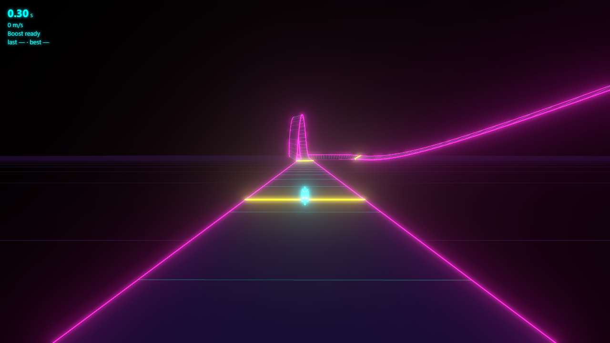

# racing_game

A browser-based neon/synthwave time trial. Ride one Bike round one closed Track: a Loop, a Wall-ride, two Gaps, and turns you have to steer through. Race the clock or a Ghost of your best Lap.



**Play:** https://rokan8.github.io/racing_game/

## Controls

| Action | Keyboard | Gamepad |
|---|---|---|
| Throttle | W / ↑ | RT |
| Brake | S / ↓ | LT |
| Steer | A/D / ←/→ | Left stick |
| Boost | Space / Shift | A |
| Respawn | R | Y |

While Airborne, W/S pitch the nose and A/D yaw, to line up the landing.

## Run locally

```sh
npm install
npm run dev     # dev server
npm test        # headless physics checks
npm run build   # production build to dist/
```

Built with Three.js, TypeScript and Vite. Pushes to `main` deploy to GitHub Pages.

## Docs

- [`docs/poc-spec.md`](docs/poc-spec.md): the spec, handling values and milestones.
- [`GLOSSARY.md`](GLOSSARY.md): the game's vocabulary.
